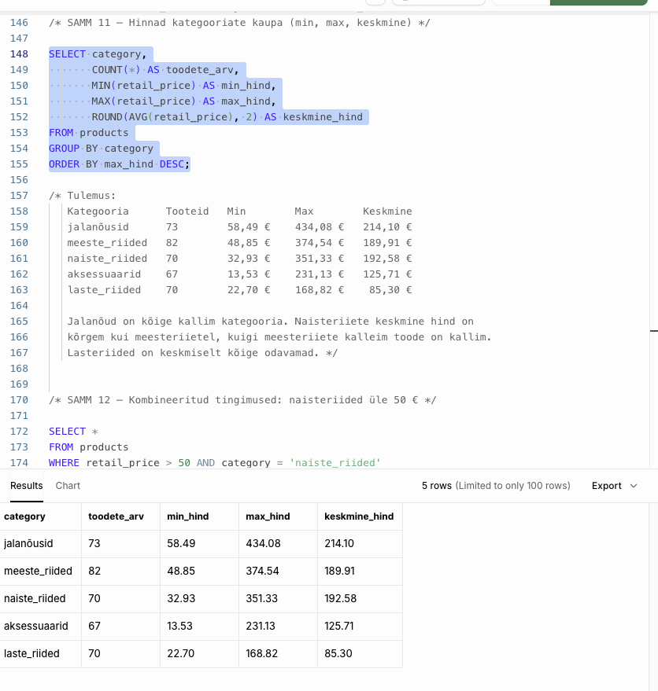
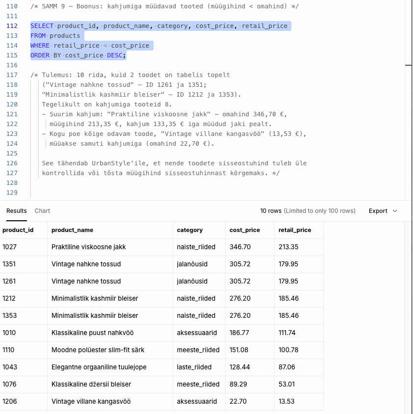

# Nädal 1: SQL alused – UrbanStyle'i tooteandmete uurimine

## Meeskond
UrbanStyle G2 – Kliendid-Turundus
Minu roll: liige C – tooteandmed (`products` tabel)

## Mida ma tegin
- Uurisin `products` tabelit SQL päringutega Supabase'is.
- Tabelis on 362 toodet ja 9 veergu. Tooted jagunevad 5 kategooriasse: jalanõusid, meeste_riided, naiste_riided, laste_riided ja aksessuaarid.
- Hinnad jäävad vahemikku 13,53 € kuni 434,08 €.
- Kontrollisin puuduvaid väärtusi ja otsisin boonusena tooteid, mida müüakse kahjumiga.
- Edasijõudnute osas võrdlesin kategooriaid `GROUP BY` abil (toodete arv, min, max ja keskmine hind).

## Peamised leiud
- **Puuduvad ökomärgised:** 18 tootel 362-st (umbes 5%) puudub info ökomärgise kohta. Hindades ja kategooriates puuduvaid väärtusi ei ole.
- **Kahjumiga tooted:** 8 toodet müüakse odavamalt kui nende omahind. Suurim kahjum on "Praktiline viskoosne jakk": omahind 346,70 €, müügihind 213,35 €, ehk 133,35 € kahjumit iga müüdud jaki pealt.
- **Duplikaadid:** tabelis on topelt tooteid (sama nimi ja hind, erinev ID), näiteks "Minimalistlik kashmiir bleiser" (ID 1212 ja 1353).
- **Kategooriad:** jalanõud on kõige kallim kategooria (keskmine 214,10 €), lasteriided kõige odavam (keskmine 85,30 €).

## Mida see UrbanStyle'ile tähendab
Hindu ja kategooriaid saab aruandluses kindlalt kasutada, kuid 18 toote ökomärgis tuleb üle kontrollida, muidu on ökotoodete aruanne ebatäpne. Kahjumiga toodete sisseostuhind tuleb üle vaadata või tõsta müügihind omahinnast kõrgemaks. Duplikaadid tuleb enne edasist analüüsi eemaldada.

## Peamised õpid
- SQL-i järjekord on alati SELECT → FROM → WHERE → GROUP BY → ORDER BY → LIMIT. Alguses kirjutasin FROM-i enne SELECT-i ja LIMIT-i enne ORDER BY-d.
- `COUNT(*)` loeb kõik read, aga `COUNT(veerg)` jätab NULL-väärtused välja. Nende vahe näitab puuduvaid väärtusi.
- Alias (`AS toodete_arv`) on ainult tulemuse veeru nimi, mitte tabel. Seda ei saa kasutada FROM-is.
- Komad ja sulud on olulised: iga SELECT-i veerg eraldatakse komaga, viimase järele koma ei käi, ja `ROUND(AVG(veerg), 2)` vajab õiges kohas koma ja sulge.
- Andmed ei ole alati korras: tuleb kontrollida puuduvaid väärtusi, duplikaate ja loogikavigu (nt müügihind alla omahinna).

## AI kasutamine
Kasutasin Perplexity AI-d juhendajana: see selgitas uusi mõisteid ja päringute ülesehitust ning kontrollis minu kirjutatud päringuid ja vigu. Enamiku päringuid kirjutasin ise, AI aitas boonuspäringu ja kommentaaride sõnastusega. Kõik tulemused kontrollisin ise Supabase'is üle.

## Failid
- [week1_products_exploration.sql](individual/week1_products_exploration.sql) – minu SQL päringud koos kommentaaride ja järeldustega
- [week1_results_screenshot.png](individual/week1_results_screenshot.png) – tulemuste pilt
- [week1_results_kahjumiga_tooted.png](individual/week1_results_kahjumiga_tooted.png) – kahjumiga toodete päringu tulemus
- [week1_data_landscape.md](team/week1_data_landscape.md) – viide meeskonna tööle

## Tulemused

## Meeskonna töö
- Meeskonna repo: https://github.com/kairikiik-hub/UrbanStyle-G2----Kliendid-Turundus
- Data Landscape: https://docs.google.com/presentation/d/15duT6ha-sxmhAaf42gZj1zVSfvYHL4yzM5Gi4l76k1I/edit?usp=sharing
