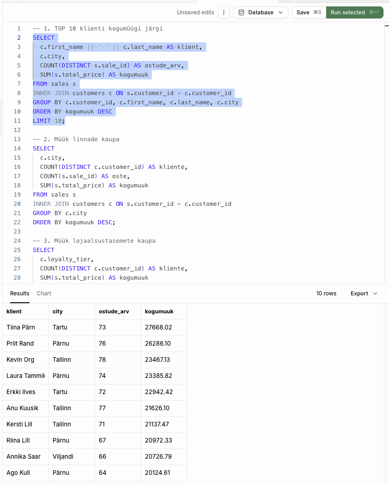
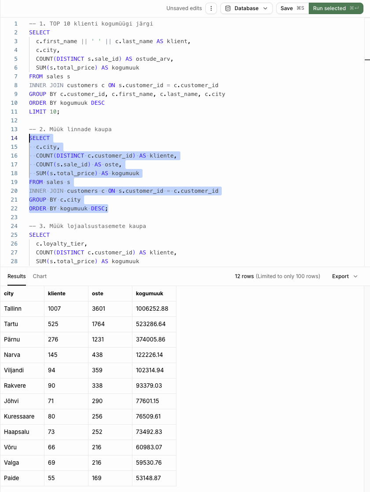
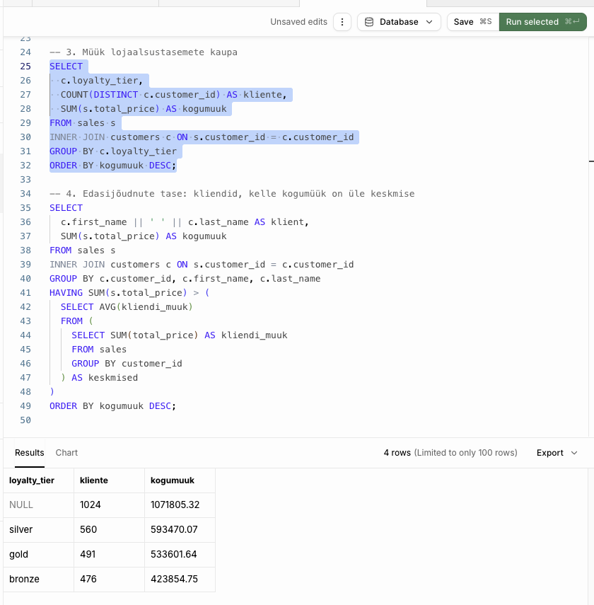

# Nädal 3: SQL JOINid (UrbanStyle)

**Minu roll:** A, müük ja kliendid (tabelid `sales` ja `customers`, INNER JOIN).

**Kontekst:** meeskond UrbanStyle G2 – Kliendid-Turundus vastab turundusjuht Anna Metsa küsimustele, ühendades tabeleid JOIN-lausetega. Iga liige võtab ühe rolli: A (müük + kliendid), B (kliendid ilma ostudeta), C (tooted + inventuur), D (müügikanalid).

Meeskonna ühisraport: [team/week3_team_join_report.md](team/week3_team_join_report.md)

Meeskonna esitlus: [UrbanStyle G2 Nädal 3 esitlus](https://docs.google.com/presentation/d/1_Ft9nK9J098MdFqELLU8sawzKJsgkvK8X-9ry-ssxhU/edit)

Meeskonna repo: [UrbanStyle-G2----Kliendid-Turundus](https://github.com/kairikiik-hub/UrbanStyle-G2----Kliendid-Turundus)

## Minu osa

- [individual/week3_roll_a_myyk_kliendid.sql](individual/week3_roll_a_myyk_kliendid.sql): kontrollpäringud, TOP 10 kliendid, müük linnade ja lojaalsustasemete kaupa ning üle keskmise kulutajad (alampäring).
- Ekraanipildid tulemustest: [individual/screenshots/](individual/screenshots/)

## Peamine tulemus

TOP 10 klienti toovad 8,7% müügist (228 337 € kogumüügist 2 622 732 €). Tallinn annab 38% müügist, aga Pärnu klient kulutab kõige rohkem (1 355 € vs Tallinn 999 €). 762 klienti (30% aktiivsetest) kulutab üle keskmise.

## Tulemused

TOP 10 kliendid kogumüügi järgi:

Müük linnade kaupa:

Müük lojaalsustasemete kaupa:

| Näitaja | Tulemus |
|---|---|
| Müügiridu pärast puhastust | 10 118 |
| Müügiread kliendiga (INNER JOIN) | 9 130 |
| Müügiread ilma kliendita | 988 |
| Aktiivsed / kadunud kliendid | 2 551 / 599 (kokku 3 150) |
| Parim klient | Tiina Pärn, Tartu, 27 668 € (73 ostu) |
| Tallinna osa müügist | 38,4% |
| Lojaalsustase puudub | 1 024 klienti, 41% müügist |

## Mida see UrbanStyle'ile tähendab

Müük on koondunud Tallinna ja TOP klientide kätte, kuid Pärnu kliendid on väärtuslikumad kliendi kohta. Soovitus Annale: keskenduda TOP klientide ja üle keskmise kulutajate hoidmisele, panna Pärnule rohkem tähelepanu ning määrata lojaalsustase ka tasemeta klientidele. 988 müügirida ei seostu ühegi kliendiga, seega on klientide ja linnade summad 9 130 rea põhjal.

## Peamised õpid

- INNER JOIN jätab välja read ilma vasteta, seega tasub ridade arvu alati kontrollida (10 118 vs 9 130).
- LEFT JOIN + `WHERE ... IS NULL` leiab read, millel puudub vaste (kadunud kliendid, kliendita müügiread).
- ON-tingimus peab siduma kaks eri tabelit (`s.customer_id = c.customer_id`), vastasel juhul on tulemus vale.
- Pärast `GROUP BY` tuleb sorteerida aliase või agregaadi järgi, mitte grupeerimata veeru järgi.

## AI kasutamine

Kasutasin Perplexity AI-d juhendajana: see selgitas JOIN-ide loogikat ja aitas veateateid lugeda. Päringud kirjutasin ja käivitasin ise ning tulemused kontrollisin Supabase'is.
